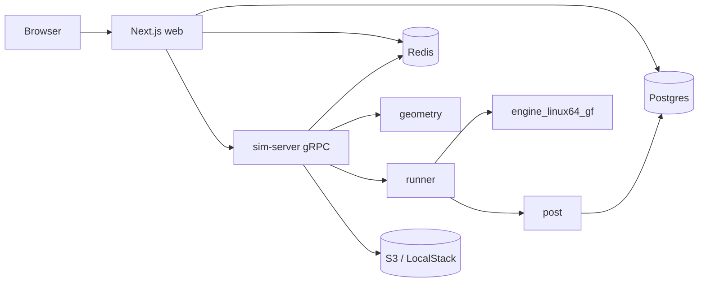

# SimStudio

A workbench for OpenRadioss explicit studies. You register, submit a fork template or a starter/engine deck pair, and watch the run move from mesh to starter to the OpenMP engine. When it finishes, the page shows peak wall force, maximum von Mises stress, plastic strain, an energy-balance check, downloadable artifacts, and a frame viewer.

The public solver binaries ship as [OpenCourant](https://github.com/OpenCourant/OpenCourant), the community continuation of OpenRadioss. The old OpenRadioss GitHub URL 404s. The deck format is unchanged (`*_0000.rad` then `*_0001.rad`). This repo runs **`engine_linux64_gf`** (OpenMP). `OMP_NUM_THREADS` defaults to 2 and is set from the environment or from the study's thread count. It does not call `engine_linux64_gf_ompi`; that MPI build fails here.

The sim-server image pins OpenCourant release **`latest-20261011`**, file `OpenCourant_linux64.zip`, sha256 `6cb419677ca36d73acb96218cc0cf5e4f7d50494d9c7812ba27935e3c0f8ec94` (the GitHub release asset digest). `INSTALL_SOLVER=true` downloads that zip and checks the sum before unpacking.



## Layout

| Path | Owner |
| --- | --- |
| `proto/simstudio.proto` | gRPC contract |
| `web/prisma` | **Schema owner.** Prisma migrations are the only place the tables are created. |
| `web/` | Next.js UI, auth, and the gRPC client |
| `sim-server/geometry/` | Photo, STL, or fork template → Radioss hex mesh. See `sim-server/geometry/README.md`. |
| `sim-server/runner/` | `gen_deck45.py` (force), `gen_deck.py` (velocity), `launch.sh`, `watch.py`, `env.sh` |
| `sim-server/post/` | Time history, `summary.json`, comparison, viewer frames |
| `infra/terraform/` | AWS sketch. `terraform validate` only; do not apply from CI. |

## gRPC

Package `simstudio.v1`, service `SimStudio`:

- `SubmitSim` — fork template (`fork_load` or `fork_displacement`) or an uploaded `*_0000.rad` / `*_0001.rad` pair
- `GetStatus` — latest state
- `StreamStatus` — server stream of status
- `ListSims` — the caller's studies
- `GetResults` — `summary.json` plus peak force (N), max von Mises (Pa), max plastic strain, energy-balance error (%)
- `CancelSim`

States: `QUEUED`, `MESHING`, `RUNNING_STARTER`, `RUNNING_ENGINE`, `POSTPROCESSING`, `SUCCEEDED`, `FAILED`, `CANCELLED`.

The browser does not speak gRPC. The web app subscribes to Redis for the live listing and calls gRPC to submit or cancel.

## Module interfaces

```python
geometry.build_fork(profile="realistic", nz=5, dx=0.8, dy=0.35) -> HexMesh
geometry.image_to_mesh(path, length_mm, thickness_mm=2.0, ...) -> HexMesh
geometry.stl_to_mesh(path, voxel_mm=1.0, place_on_floor=False) -> HexMesh
mesh.export_all(out_dir)  # model.inc, model.stl, model.vtk, model.glb, model.json

runner.generate_decks(spec: DeckSpec) -> DeckFiles
runner.solver_environment(threads) -> dict
runner.launch_engine(run_dir, name, threads, stop_displacement_mm=40) -> LaunchResult
runner.engine_binary_name()  # "engine_linux64_gf"

post.process_run(run_dir, out_dir) -> metrics  # writes gltf/<name>.glb; metrics["glb"]
post.frames_to_glb(...) / post.to_gltf_coords(points, scale)
post.metrics_to_rows(metrics, sim_id) -> sim_metrics rows
post.artifact_manifest(out_dir) -> S3 upload list  # .glb is model/gltf-binary
post.compare_runs(run_dirs, labels, out_dir) -> comparison
post.build_viewer(run_dirs, labels, out_html) -> HTML path
```

`model.json` from geometry is stored on `simulations.summary.geometry`. `process_run` metrics are stored as `simulations.summary`, and `metrics_to_rows` fills `sim_metrics` (`sim_id`, `name`, `value`, `unit`). Artifact keys are `sims/<id>/post/` plus the manifest suffix, and the input `model.glb` is stored under `sims/<id>/input/`.

The create page shows that part preview before a run. The results page loads one binary glTF. The surface is built once from frame 1. Each frame is a morph target, played by a STEP animation (`LoopOnce`, `clampWhenFinished`, slowed with `timeScale`). `COLOR_0` is von Mises for the last frame only. The page recolours from `_VON_MISES_####` and `_PLASTIC_STRAIN_####` (three.js lower-cases those names) using the fixed range in mesh extras. More than eight morph targets needs WebGL2. Eroded elements are collapsed onto their centroids, so the viewer does not discard faces. Both files are meters and Y-up, `gltf = (x, z, -y) * scale` (`scale` is 1e-3 for mm decks). A solver push along −Z points down (−Y). The undeformed part toggles into the same scene with no extra transform. When converters are absent, the pipeline attaches `post/samples/sample.glb` instead of a synthetic mesh. MP4 and GIF stay downloadable previews.

### Units

Fork decks are **kg, mm, ms**. Stress in the solver is GPa, so pascals are that value times `1e9`. Force in the solver is kN, so newtons are that value times `1000`. The rigid-wall time history stores **cumulative impulse**. Post differentiates it before anything is reported as a force. Parts stand tines-down, long axis along +Z, lowest point 1 mm above a floor at Z = 0. The push is along −Z, which is −Y after the glTF mapping.

### Postgres tables

`users`, `simulations`, `sim_metrics`, `artifacts`. Created only by `web/prisma/migrations`.

## Run locally

```bash
docker compose up --build
```

Open [http://127.0.0.1:43123](http://127.0.0.1:43123). Register, submit a fork study, and leave **Dry run** checked. The mock path still meshes with `geometry.build_fork`, writes real starter and engine decks, synthesizes a listing and a cumulative wall impulse, then fills `summary.json` and the viewer.

`SIM_MODE` defaults to `mock`, so a dry run is not required for the stack to come up, and an unchecked dry run still will not call a missing binary. Set `SIM_MODE=auto` and `INSTALL_SOLVER=true` to download the pinned OpenCourant `latest-20261011` zip, verify its sha256, and run `starter_linux64_gf` then `engine_linux64_gf`. Override the default thread count with `OMP_NUM_THREADS` (the study's thread field still wins for that engine process).

```bash
INSTALL_SOLVER=true SIM_MODE=auto OMP_NUM_THREADS=2 docker compose up --build
```

Development placeholders live in `.env.example`, `web/.env.example`, and `sim-server/.env.example`. Nothing in the repo is a production secret. Compose uses `radlab` / `radlab` for Postgres and `test` / `test` for LocalStack, which are the usual local stand-ins.

## Tests

```bash
cd sim-server
pip install -e ".[dev]"
pytest geometry/tests post/tests tests -q

cd ../web
npm ci
npm test
npm run lint
npm run build
```

`geometry/tests` is the teammate mesh package (9 tests; the photo fixture is skipped when that file is not on the machine). `post/tests` is the teammate results package (23 tests when the ball-hits-wall demo at `/workspace/openradioss/results/demo` is present; those cases skip otherwise). The three.js check also skips without `google-chrome`. Converters are `anim_to_vtk_linux64_gf` and `th_to_csv_linux64_gf` from `OPENRADIOSS_EXEC`. Rendering uses VTK’s EGL window (`VTK_DEFAULT_OPENGL_WINDOW=vtkEGLRenderWindow`).

## AWS

```bash
cd infra/terraform
terraform init -backend=false
terraform validate
```

The stack describes a VPC, an ALB, Fargate for the web task, EC2-backed ECS for the sim workers, RDS Postgres, ElastiCache Redis, a private S3 bucket, ECR repositories, and a Secrets Manager secret for the database password (`random_password`, not a committed value). Replace `ecs_ami_id` before any apply. This repository does not run `terraform apply`.

## Gaps

- Dry-run viewer frames are a lateral buckle of the real surface, not solver displacements. A real run still converts animation files when `anim_to_vtk` and the optional post stack (pyvista) are installed; otherwise the lightweight summary is what Postgres stores.
- `compare.py` and `make_viewer.py` are in `sim-server/post` for the study workflow. The web page is a single-run viewer with the same jet scale, floor, and playhead.
- Photo and STL entry points are the geometry package CLI and API. The web form submits the fork template or an uploaded deck pair.
- gRPC is trusted only on the private network. There is no email verification.
